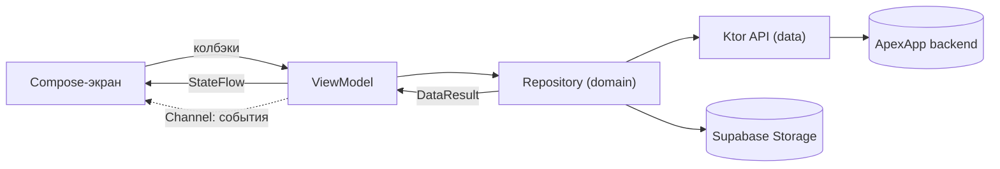

# ApexHR — Android-клиент платформы вовлечённости сотрудников

ApexHR — мобильное приложение для корпоративной платформы вовлечённости сотрудников
ApexHR / ApexApp, сделанное как решение кейс-чемпионата. Сотрудники проходят квесты,
отвечают на опросы, ходят на мероприятия, благодарят коллег и получают за это
внутреннюю валюту — **апексы**. Апексы тратятся в каталоге наград компании.

Приложение работает с тем же бэкендом, что и
[веб-версия](https://github.com/distunt8/apexteam), и повторяет её логику:
суммы, лимиты, тексты и порядок блоков.

- Бэкенд (REST API, Swagger): https://apexapp-backend.onrender.com
- Веб-версия: https://github.com/distunt8/apexteam

## Возможности

### Главная
- Приветствие, баланс в апексах и колокольчик с числом непрочитанных уведомлений.
- Карточка **уровня активности**: текущий уровень, очки и прогресс до следующего уровня.
- Ближайшие квесты, лидерборд, **новости компании**, достижения.
- **Лента благодарностей**: последние благодарности и поощрения с участием пользователя.

### Активности
- Вкладки: **опросы**, **квесты**, **мероприятия** и **достижения**, а также поиск по активностям.
- Опросы: прохождение и отправка ответов, награда в апексах.
- Квесты: участие, шаги и подтверждение шага фотографией (загрузка в Supabase Storage).
- Мероприятия: запись и отмена записи, статусы участия.
- Достижения: полученные и ещё закрытые, с условием открытия.
- Экран **«Моя активность»**: мои квесты, опросы, мероприятия, достижения и разбивка
  уровня активности по источникам.
- Списки подгружаются постранично.

### Каталог
- Категории, поиск, сортировка, постраничный просмотр, карточка товара с вариантами.
- Корзина: количество, удаление, оформление заказа за апексы.
- «Мои заказы» со статусами и составом.

### Профиль
- Фото профиля (загрузка в Supabase Storage), должность и отдел, уровень активности, баланс.
- Вкладки: **благодарности** (полученные и отправленные), **достижения** и **операции**
  (история начислений и списаний с фильтрами).
- Профиль коллеги с возможностью поблагодарить его.

### Благодарности и поощрение руководителя
- Благодарность коллеге ничего не стоит отправителю, коллега получает 25 апексов;
  одному человеку — не чаще раза в неделю.
- **Поощрение руководителя**: сотрудники с ролью руководителя могут поощрить коллегу
  суммой с рабочего баланса.

### Уведомления, поддержка, новости
- **Уведомления**: список, отметка о прочтении и «Прочитать все».
- **Поддержка**: обращения, переписка внутри обращения и статусы.
- **Новости компании**: лента с подгрузкой и экран новости с обложкой.

### Настройки
- **Тема**: «Как в системе», «Светлая» или «Тёмная».
- Смена пароля и выход из аккаунта.

## Стек

| Область | Технологии |
|---|---|
| Язык | Kotlin 2.3.20, Java 11 (source/target) |
| UI | Jetpack Compose (BOM 2026.02.01), Material 3, Material Icons Extended |
| Навигация | Navigation 3 (`navigation3` 1.3.0-alpha02, `lifecycle-viewmodel-navigation3` 2.12.0-alpha04) |
| DI | Koin 4.2.2 |
| Сеть | Ktor Client 3.6.0 (OkHttp, Auth, Content Negotiation, Logging), kotlinx.serialization 1.11.0 |
| Хранение | DataStore Preferences 1.3.0 (токены и настройки) |
| Изображения | Coil 3.6.3 |
| Файлы | Supabase Storage (фото профиля, фото-подтверждения квестов) |
| Тесты | JUnit 4.13.2, kotlinx-coroutines-test 1.11.0 |
| Сборка | Android Gradle Plugin 9.2.1, Gradle 9.4.1 |

Вход — через API бэкенда (`/api/Auth/login`). Выданный токен — JWT Supabase,
им же приложение авторизуется в Supabase Storage.

## Архитектура

MVVM с однонаправленным потоком данных (UDF):

- **ViewModel** хранит состояние экрана в `StateFlow` (обычно `Loading` / `Error` / `Content`)
  и реализует интерфейс колбэков экрана `XxxScreenCallbacks`.
- **Экран** — Composable, который получает состояние и колбэки и только рисует.
  Переходы задаёт навигация через `object : XxxScreenCallbacks by viewModel { … }`.
- **Одноразовые события** (сообщения, переходы после действия) — через `Channel`.
- **Данные** приходят из репозиториев как `DataResult<T>` (`Success` / `Failure(DataError)`).
  `DataError` — это `Unauthorized`, `Timeout`, `Network`, `Server`, `Unknown`.
- **Маппинг по слоям**: DTO → доменная модель (`toDomain`) → UI-модель (`toUiModel`).



### Структура пакетов

```text
app/src/main/java/com/example/apexhr/
├── core/
│   ├── data/        # сеть (Ktor, NetworkConfig, safeApiCall), DataStore, общие DTO
│   ├── di/          # модули Koin: сеть, данные, репозитории, ViewModel
│   ├── domain/      # DataResult, DataError, токены и сессия
│   └── ui/          # общие компоненты, модели UI, навигация (Routes, AppNavigation), тема
└── features/
    ├── activities/  # опросы, квесты, мероприятия, достижения, «Моя активность»
    ├── auth/        # вход
    ├── colleague/   # профиль коллеги
    ├── engagement/  # уровень активности
    ├── home/        # главная и лента благодарностей
    ├── news/        # новости компании
    ├── notifications/
    ├── profile/     # профиль, операции, фото
    ├── settings/    # тема и смена пароля
    ├── shop/        # каталог, корзина, заказы
    ├── support/     # обращения в поддержку
    └── thanks/      # благодарности и поощрение руководителя
```

Каждая фича разделена на слои `data` (API, DTO, мапперы, реализация репозитория),
`domain` (модели и интерфейс репозитория) и `ui` (экраны, ViewModel, UI-модели).

## Требования

- Android Studio с поддержкой AGP 9.2 (JDK 17+, например встроенный JBR).
- Android SDK 36 (`compileSdk` / `targetSdk` 36).
- Устройство или эмулятор с Android 10+ (`minSdk` 29).
- Доступ в интернет: приложение работает с живым бэкендом. Бэкенд размещён на Render,
  поэтому первый запрос после простоя может идти дольше обычного.

## Сборка, запуск и тесты

```bash
# Debug-сборка APK (app/build/outputs/apk/debug/)
./gradlew assembleDebug

# Установка на подключённое устройство или эмулятор
./gradlew installDebug

# Юнит-тесты
./gradlew test
```

На Windows используйте `gradlew.bat`. Можно также открыть проект в Android Studio
и запустить конфигурацию `app`.

Юнит-тесты лежат в `app/src/test` и работают без сети: ViewModel, репозитории
и мапперы проверяются на фейковых API и живых образцах ответов сервера.

Учётную запись для входа выдаёт администратор платформы ApexApp.